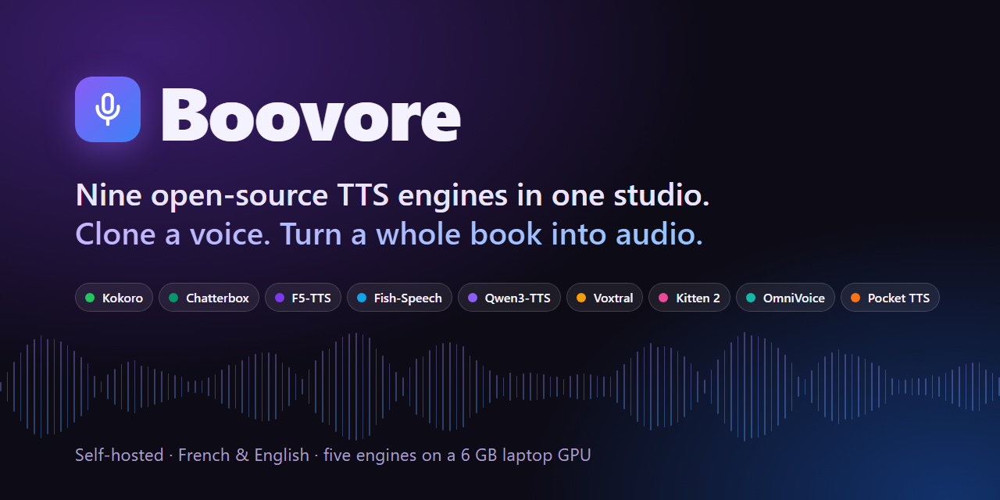
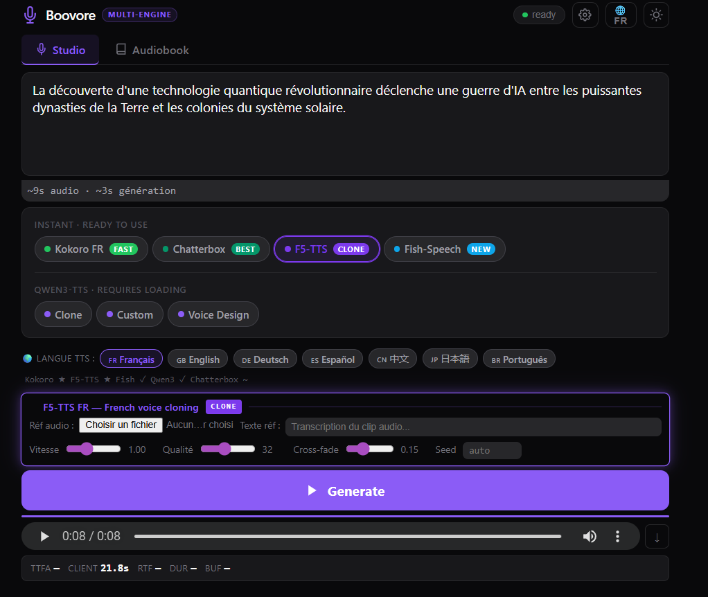

<p align="center">
  
</p>

<p align="center">
  <a href="https://huggingface.co/spaces/terrancemoon9/Boovore_Multi-Engine-TTS-Studio"></a>
  <a href="../LICENSE"></a>
  
  
  
</p>

<p align="center">
  <b>English</b> · <a href="../README.fr.md">Français</a>
</p>

**Boovore** is a self-hosted text-to-speech studio. It puts nine open-source TTS engines behind one web page, so you can hear the same sentence in every engine, clone a voice from a short clip, and turn a `.txt`, `.pdf` or `.epub` into a chaptered audiobook.

It is French-first (good French voices are hard to find in open-source TTS) and runs on whatever you have: a free CPU Space, a 6 GB laptop GPU, or a 24 GB server.

> **The name:** Boovore = *book* + *-vore* (devourer). It was built to devour books into audio.

<p align="center">
  
</p>

## Why Boovore?

- **Compare engines in one click.** Same text, same page, nine engines. You find the right voice by listening instead of installing nine repos.
- **Books, not just sentences.** Import a `.txt`, `.pdf` or `.epub`, let Boovore detect the chapters, generate them in batch, then download each chapter or merge everything into one WAV.
- **Voice cloning and voice design.** Clone a voice from a few seconds of audio (OmniVoice, Chatterbox, F5-TTS, Fish-Speech, Qwen3, Voxtral, Kitten), describe a voice and let Qwen3 Voice Design or OmniVoice create it, or add a sigh or a laugh with Kitten's emotion tags.
- **Runs on modest hardware.** The `ENABLED_ENGINES` switch loads only what your machine can hold. A 6 GB RTX 2060 laptop runs five engines: Qwen3 and OmniVoice take turns on the GPU, Kokoro, Pocket TTS and Kitten use the CPU.
- **One plain web page.** The UI is a single HTML file in vanilla JS with no build step, and the backend is a single FastAPI file with a documented HTTP API.

## Engines

| Engine | Good at | Voice cloning | Weights license | Commercial use |
|---|---|:---:|---|:---:|
| **[Kokoro 82M](https://huggingface.co/hexgrad/Kokoro-82M)** | Fast, natural French voice (`ff_siwis`) plus English voices; runs on CPU | — | Apache-2.0 | ✅ |
| **[Chatterbox](https://github.com/resemble-ai/chatterbox)** (Resemble AI) | Expressive zero-shot cloning with an emotion slider (English model) | ✅ | MIT | ✅ |
| **[F5-TTS FR](https://huggingface.co/RASPIAUDIO/F5-French-MixedSpeakers-reduced)** | French voice cloning; runs on CPU | ✅ | CC-BY-NC-4.0 | ❌ |
| **[Fish-Speech 1.5](https://github.com/fishaudio/fish-speech)** | Multilingual cloning | ✅ | CC-BY-NC-SA-4.0 | ❌ |
| **[Qwen3-TTS](https://huggingface.co/Qwen/Qwen3-TTS-12Hz-1.7B-Base)** 0.6B / 1.7B | Three modes (clone, built-in speakers, **Voice Design** from a text description), streaming with CUDA graphs | ✅ | Apache-2.0 | ✅ |
| **[Voxtral 4B](https://huggingface.co/mistralai/Voxtral-4B-TTS-2603)** (Mistral AI) | French-first cloning. In Mistral's own human evaluation, listeners preferred it over ElevenLabs Flash v2.5 in [68.4% of zero-shot cloning comparisons](https://mistral.ai/news/voxtral-tts/) | ✅ | CC-BY-NC-4.0 | ❌ |
| **[Kitten TTS 2](https://huggingface.co/KittenML/kitten-tts-2)** (KittenML) | 47 voices and emotion tags (`[sad]`, `<sigh>`, `<laugh>`, `(((emphasis)))`); French through one built-in voice or cloning. Runs on CPU, but slowly (about 0.1× real time on a 6-core laptop) | ✅ | [Stellon Labs Community License](https://huggingface.co/KittenML/kitten-tts-2/blob/main/LICENSE.md) | ⚠️ under US$1M revenue, after registering |
| **[OmniVoice](https://huggingface.co/k2-fsa/OmniVoice)** (k2-fsa) | Best French scores on Hugging Face's Open TTS Leaderboard (4.7 % word errors, Oct 2026), #2 for English cloning; cloning and voice design (gender, age, pitch, accent). About 2 GB of VRAM | ✅ | CC-BY-NC | ❌ |
| **[Pocket TTS](https://github.com/kyutai-labs/pocket-tts)** (Kyutai) | Fast on CPU: 2.3× real time in French on a 6-core laptop, one thread. 7 languages, 27 voices | ✅ (gated weights) | CC-BY-4.0 | ✅ |

Boovore's own code is MIT. Each engine's **model weights** keep their own license (column above). Check it before you publish or sell audio.

## Quick start

### 1. Try it online

Open the **[Hugging Face Space](https://huggingface.co/spaces/terrancemoon9/Boovore_Multi-Engine-TTS-Studio)**. It runs Kokoro on the free CPU tier. The Space sleeps when idle, so the first visit can take about a minute. To try every engine, run Boovore on a GPU (below).

### 2. Docker (CPU: Kokoro + F5-TTS)

```bash
git clone https://github.com/Foradc/Boovore-tts.git && cd Boovore-tts
docker build -t boovore .
docker run -p 7860:7860 -e ENABLED_ENGINES=kokoro,f5 boovore
# open http://localhost:7860
```

The first request to each engine downloads its model. Kokoro is fast on CPU. F5-TTS works but is slow there: about 3 minutes for one short sentence on a 6-core laptop CPU.

### 3. GPU server (all engines)

Tested on an RTX 3090 (24 GB) rented on Vast.ai, Python 3.12 with CUDA 12.8.

<details>
<summary><b>Install steps</b></summary>

```bash
# PyTorch nightly, CUDA 12.8
pip3 install --pre torch torchaudio --index-url https://download.pytorch.org/whl/nightly/cu128
# Let torchaudio find libtorch
echo "/usr/local/lib/python3.12/dist-packages/torch/lib" > /etc/ld.so.conf.d/torch.conf && ldconfig

# Core engines
pip3 install faster-qwen3-tts kokoro f5-tts fastapi "uvicorn[standard]" python-multipart

# Chatterbox (Python 3.12 fix)
pip3 install conformer==0.3.2 --no-build-isolation
git clone https://github.com/resemble-ai/chatterbox /tmp/chatterbox
cd /tmp/chatterbox && pip3 install -e . --no-deps && cd -

# Fish-Speech 1.5
git clone https://github.com/fishaudio/fish-speech /tmp/fish-speech
cd /tmp/fish-speech && git checkout v1.5.1 && pip3 install -e . --no-deps && cd -
huggingface-cli download fishaudio/fish-speech-1.5 --local-dir /root/fish-speech-model

# Start Boovore
nohup python3 server.py --port 7860 >> server.log 2>&1 &
```

**Voxtral (optional).** It runs as a separate vLLM-Omni process and needs about 8 GB of VRAM. First accept the license on [mistralai/Voxtral-4B-TTS-2603](https://huggingface.co/mistralai/Voxtral-4B-TTS-2603), then:

```bash
pip install "vllm[audio]>=0.18.0" httpx soundfile
export HF_TOKEN=hf_xxxx
python3 voxtral_server.py            # --status / --stop
python3 make_narrator_reference.py   # optional: build a narrator reference WAV with Qwen3
```

**Kitten TTS 2 (optional).** It needs transformers 5.x while Qwen3-TTS pins 4.57, so it runs in its own environment as a small server on port 7862 that Boovore calls:

```bash
python3 -m venv /root/kitten-env
/root/kitten-env/bin/pip install kittenml fastapi uvicorn python-multipart
nohup /root/kitten-env/bin/python kitten_server.py >> kitten.log 2>&1 &   # KITTEN_DEVICE=cuda to use the GPU
```

Open the UI through an SSH tunnel: `ssh -p <PORT> root@<HOST> -L 7860:localhost:7860 -N`, then go to http://localhost:7860.

</details>

### 4. Windows laptop with a 6 GB GPU (five engines)

Create a `venv\` with PyTorch (CUDA), `faster-qwen3-tts`, `kokoro` and `pocket-tts`, then double-click **`start_qwen3_local.bat`**. It opens http://localhost:7860 once the model is loaded. It was tested with Python 3.12, torch 2.7.1+cu118 and faster-qwen3-tts 0.2.4 on an RTX 2060 laptop.

To add Kitten TTS 2, run **`setup_kitten.bat`** once. It builds a separate environment in `%LOCALAPPDATA%\boovore\kitten-env` (outside the project folder, so cloud sync skips 1.5 GB). After that, `start_qwen3_local.bat` also starts Kitten on the CPU, leaving the GPU to Qwen3. Kitten opens in its own minimized window: close it too when you stop Boovore.

To add OmniVoice, run **`setup_omnivoice.bat`** once (or, if OmniVoice is already installed elsewhere, put `set OMNIVOICE_ENV=<that venv>` in a `local_env.bat` next to the launchers). OmniVoice then starts in its own window too. Qwen3 and OmniVoice take turns on the GPU: when OmniVoice needs room, Boovore unloads Qwen3; when you press **Load** for Qwen3, OmniVoice gives the card back. They never run on the GPU at the same time.

<details>
<summary><b>What the launcher sets, and why</b></summary>

| Variable | Value | Why |
|---|---|---|
| `ENABLED_ENGINES` | `qwen3,kokoro,pocket`, plus `kitten` and `omnivoice` once their setup has run | Qwen3, Kokoro and Pocket live in the local venv; Kitten and OmniVoice run in their own environments |
| `MODEL_CACHE_SIZE` | `1` | 6 GB holds one 1.7B model (about 4.5 GB peak). Loading another one unloads it and frees the VRAM |
| `TRANSCRIBE_DEVICE` | `off` | The reference-clip transcriber does not fit next to a 1.7B model |
| `QWEN3_DTYPE` | `auto` | bf16 on Ampere and newer. On Turing (RTX 20xx, T4): fp16 for 1.7B and bf16 for 0.6B, because 0.6B overflows in fp16 |

Measured on an RTX 2060 laptop: French output was word-exact (checked by speech recognition), but speed was only 0.1 to 0.5× real time because the GPU throttles when it heats up. For long audiobooks, use a desktop GPU or a rented one.

</details>

## Pick engines for your hardware

| `ENABLED_ENGINES` | Hardware | Engines |
|---|---|---|
| `kokoro,f5` | CPU (e.g. free HF Space) | Kokoro, F5-TTS |
| `kokoro,f5,chatterbox` | GPU with about 6 GB (e.g. T4) | + Chatterbox |
| `qwen3,omnivoice,kokoro,pocket,kitten` | 6 GB laptop GPU | Qwen3 and OmniVoice take turns on the GPU; Kokoro, Pocket and Kitten on the CPU |
| `all` (default) | 24 GB GPU (RTX 3090, A10G, A100) | Everything (Voxtral, Kitten and OmniVoice also need their own server) |

Other settings: `ACTIVE_MODELS` (comma-separated list of the Qwen3 models offered in the UI), `MODEL_CACHE_SIZE` (Qwen3 models kept in memory, default 2), `VOXTRAL_URL` (default `http://localhost:8000`), `KITTEN_URL` (default `http://127.0.0.1:7862`), `KITTEN_TIMEOUT` (seconds, default 3600).

Kitten server (`kitten_server.py`): `KITTEN_PORT` (7862), `KITTEN_HOST` (127.0.0.1), `KITTEN_DEVICE` (`cpu` or `cuda`), `KITTEN_WEIGHTS` (`packed` by default, `emb4` halves the download, `full`), `KITTEN_DECODER` (`default` or the smaller `student_w4`), `KITTEN_WHISPER=1` to transcribe reference clips with Whisper large-v3 (about 3 GB) when no transcript is given.

OmniVoice: `OMNIVOICE_URL` on the Boovore side (default `http://127.0.0.1:7863`) and `OMNIVOICE_TIMEOUT` (seconds, default 1800); on its server, `OMNIVOICE_PORT` (7863), `OMNIVOICE_HOST` (127.0.0.1) and `OMNIVOICE_ASR=1` to transcribe reference clips with Whisper large-v3 turbo (about 1.6 GB) when no transcript is given. It loads on the GPU when at least 3 GB are free, otherwise on the CPU.

Pocket TTS: `POCKET_THREADS` sets the CPU threads while Pocket generates (unset by default; on a 6-core laptop, 2 threads gave 2.7× real time, 6 threads 2.0×).

## HTTP API

The web page is a thin client over a FastAPI server, so you can script any engine:

```bash
# Kokoro, French voice
curl -X POST http://localhost:7860/generate/kokoro_fr \
     -F "text=Bonjour, je suis Boovore." -F "voice=ff_siwis" -o bonjour.wav

# Qwen3 Voice Design: describe the voice instead of cloning it
curl -X POST http://localhost:7860/load -F "model_id=Qwen/Qwen3-TTS-12Hz-1.7B-VoiceDesign"
# /generate (Qwen3) answers JSON with the WAV in base64, plus timing metrics
curl -X POST http://localhost:7860/generate -F "mode=voice_design" -F "language=French" \
     -F "instruct=A calm, deep male narrator, warm and slow." \
     -F "text=La nuit tombait lentement sur la plaine." \
  | python -c "import sys, json, base64; open('narrateur.wav', 'wb').write(base64.b64decode(json.load(sys.stdin)['audio_b64']))"

# OmniVoice voice design and Pocket TTS answer a WAV directly
curl -X POST http://localhost:7860/generate/omnivoice -F "language=English" \
     -F "instruct=Male, Elderly, Low Pitch, British Accent" -F "text=The night was falling." -o elder.wav
curl -X POST http://localhost:7860/generate/pocket -F "language=french" -F "voice=estelle" \
     -F "text=Bonjour, je suis Boovore." -o estelle.wav
```

| Endpoint | What it does |
|---|---|
| `GET /status` | Loaded model, available models, enabled engines |
| `POST /load` | Load a Qwen3 model (`model_id`) |
| `POST /generate`, `POST /generate/stream` | Qwen3: `voice_clone`, `custom`, `voice_design` |
| `POST /generate/kokoro_fr` | Kokoro |
| `POST /generate/f5_fr` | F5-TTS (`ref_wav`, `ref_text`) |
| `POST /generate/chatterbox` | Chatterbox (`ref_wav`, `exaggeration`) |
| `POST /generate/fish` | Fish-Speech |
| `POST /generate/voxtral` | Voxtral (proxied to vLLM-Omni) |
| `POST /generate/kitten` | Kitten TTS 2 (`voice`, `ref_wav` + `ref_text`, `preset`, `normalize`, `seed`; proxied to `kitten_server.py`) |
| `GET /kitten/status` | Kitten voices and load state |
| `POST /generate/omnivoice` | OmniVoice (`language`, `ref_wav` + `ref_text`, or `instruct`; `speed`, `seed`; proxied to `omnivoice_server.py`) |
| `GET /omnivoice/status` | OmniVoice load state and device |
| `POST /generate/pocket` | Pocket TTS (`language`, `voice`, optional `ref_wav`) |
| `POST /transcribe` | Transcribe a reference clip (nano-parakeet) |

## Project layout

```
server.py                    FastAPI backend: all engines, model cache, HTTP API
index.html                   The whole UI (studio + audiobook), vanilla JS
voxtral_server.py            Start / stop / check the Voxtral vLLM-Omni server
make_narrator_reference.py   Build a narrator reference WAV with Qwen3 Voice Design
kitten_server.py             Kitten TTS 2 server (own environment, port 7862)
setup_kitten.bat             Builds the Kitten environment on Windows
start_kitten.bat             Starts the Kitten server on Windows
omnivoice_server.py          OmniVoice server (own environment, port 7863, shares the GPU with Qwen3)
setup_omnivoice.bat          Builds the OmniVoice environment on Windows
start_omnivoice.bat          Starts the OmniVoice server on Windows
start_qwen3_local.bat        Windows launcher for 6 GB GPUs (also starts Kitten if installed)
xtts_server.py               Optional fine-tuned XTTS French narrator (port 7861)
Dockerfile                   CPU image used by the Hugging Face Space
```

## Contributing

Issues and pull requests are welcome, especially:

- a new engine (one `/generate/<engine>` endpoint plus one pill in `index.html`)
- voices and presets for languages other than French
- install reports for GPUs not listed here

For a larger change, open an issue first so we can agree on the approach.

## Credits

Boovore started as a fork of the web demo of **[faster-qwen3-tts](https://github.com/andimarafioti/faster-qwen3-tts)** by Andres Marafioti, whose CUDA-graph Qwen3 engine powers the streaming mode. The other engines are by [Resemble AI](https://github.com/resemble-ai/chatterbox), [SWivid](https://github.com/SWivid/F5-TTS) and [RASPIAUDIO](https://huggingface.co/RASPIAUDIO/F5-French-MixedSpeakers-reduced), [fishaudio](https://github.com/fishaudio/fish-speech), [hexgrad](https://github.com/hexgrad/kokoro), the [Qwen team](https://huggingface.co/Qwen), [Mistral AI](https://mistral.ai/news/voxtral-tts/) and [KittenML](https://github.com/KittenML/KittenTTS), [k2-fsa](https://github.com/k2-fsa/OmniVoice) and [Kyutai](https://github.com/kyutai-labs/pocket-tts). Kitten TTS 2 is **Powered by Stellon Labs**. The French prosody preprocessing is inspired by [arXiv:2508.17494](https://arxiv.org/abs/2508.17494).

## License

The code is released under the [MIT license](../LICENSE). Model weights are licensed separately; see the [engines table](#engines) and [NOTICE](../NOTICE).

---

<p align="center">
  If Boovore saved you an afternoon of installing TTS repos, a ⭐ helps other people find it.
</p>
