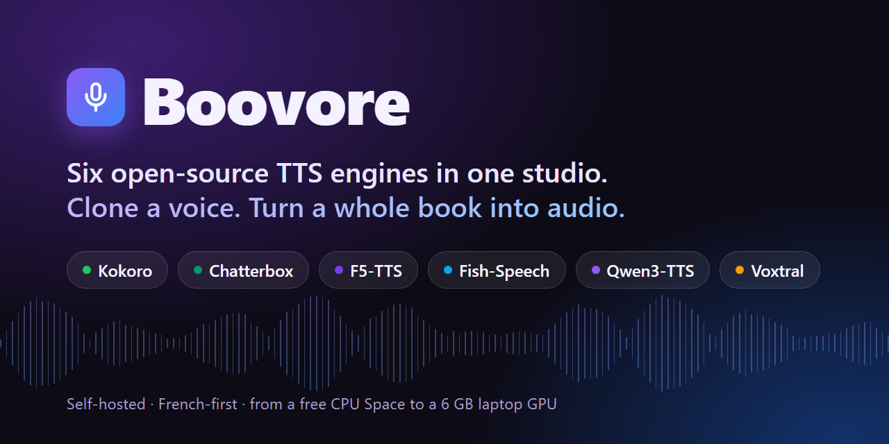
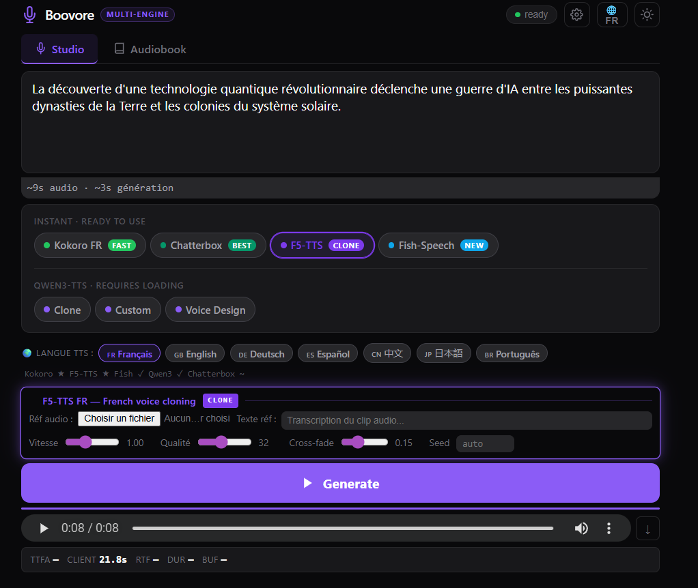

<p align="center">
  
</p>

<p align="center">
  <a href="https://huggingface.co/spaces/terrancemoon9/Boovore_Multi-Engine-TTS-Studio"></a>
  <a href="LICENSE"></a>
  
  
</p>

<p align="center">
  <a href="https://github.com/Foradc/Boovore-tts#readme">English</a> · <b>Français</b>
</p>

**Boovore** est un studio de synthèse vocale (TTS) à héberger soi-même. Il réunit six moteurs open source derrière une seule page web : on écoute la même phrase dans chaque moteur, on clone une voix à partir d'un court extrait, et on transforme un `.txt`, un `.pdf` ou un `.epub` en livre audio découpé en chapitres.

Il est pensé d'abord pour le français, parce que les bonnes voix françaises sont rares en TTS open source. Il tourne sur la machine dont vous disposez : un Space CPU gratuit, un portable avec 6 Go de VRAM ou un serveur à 24 Go.

> **Le nom :** Boovore = *book* (livre) + *-vore* (qui dévore). Il a été conçu pour dévorer des livres et les rendre en audio.

<p align="center">
  
</p>

## Pourquoi Boovore ?

- **Comparer les moteurs en un clic.** Même texte, même page, six moteurs. On choisit sa voix à l'oreille, sans installer six dépôts.
- **Des livres entiers.** Importez un `.txt`, un `.pdf` ou un `.epub`. Boovore détecte les chapitres, les génère en lot, puis vous téléchargez chaque chapitre ou un seul WAV fusionné.
- **Clonage et création de voix.** Clonez une voix à partir de quelques secondes d'audio (Chatterbox, F5-TTS, Fish-Speech, Qwen3, Voxtral), ou décrivez une voix avec des mots et laissez Qwen3 Voice Design la créer.
- **Du matériel modeste suffit.** La variable `ENABLED_ENGINES` ne charge que ce que votre machine peut tenir. Qwen3 tourne sur un portable avec une RTX 2060 de 6 Go.
- **Une simple page web.** L'interface tient dans un seul fichier HTML (JavaScript sans framework, sans compilation), et le serveur dans un seul fichier FastAPI avec une API HTTP documentée.

## Les moteurs

| Moteur | Point fort | Clonage | Licence des poids | Usage commercial |
|---|---|:---:|---|:---:|
| **[Kokoro 82M](https://huggingface.co/hexgrad/Kokoro-82M)** | Rapide, voix française naturelle (`ff_siwis`) et voix anglaises ; tourne sur CPU | — | Apache-2.0 | ✅ |
| **[Chatterbox](https://github.com/resemble-ai/chatterbox)** (Resemble AI) | Clonage expressif avec réglage de l'émotion (modèle anglais) | ✅ | MIT | ✅ |
| **[F5-TTS FR](https://huggingface.co/RASPIAUDIO/F5-French-MixedSpeakers-reduced)** | Clonage de voix en français ; tourne sur CPU | ✅ | CC-BY-NC-4.0 | ❌ |
| **[Fish-Speech 1.5](https://github.com/fishaudio/fish-speech)** | Clonage multilingue | ✅ | CC-BY-NC-SA-4.0 | ❌ |
| **[Qwen3-TTS](https://huggingface.co/Qwen/Qwen3-TTS-12Hz-1.7B-Base)** 0.6B / 1.7B | Trois modes (clonage, voix intégrées, **Voice Design** à partir d'une description), diffusion en continu avec CUDA graphs | ✅ | Apache-2.0 | ✅ |
| **[Voxtral 4B](https://huggingface.co/mistralai/Voxtral-4B-TTS-2603)** (Mistral AI) | Clonage pensé pour le français. Dans l'évaluation humaine publiée par Mistral, les auditeurs l'ont préféré à ElevenLabs Flash v2.5 dans [68,4 % des comparaisons en clonage](https://mistral.ai/fr/news/voxtral-tts) | ✅ | CC-BY-NC-4.0 | ❌ |

Le code de Boovore est sous licence MIT. Les **poids** de chaque modèle gardent leur propre licence (colonne ci-dessus) : vérifiez-la avant de publier ou de vendre un enregistrement.

## Démarrage rapide

### 1. Essayer en ligne

Ouvrez le **[Space Hugging Face](https://huggingface.co/spaces/terrancemoon9/Boovore_Multi-Engine-TTS-Studio)**. Il fait tourner Kokoro sur le CPU gratuit. Le Space se met en veille quand personne ne l'utilise : la première visite peut prendre environ une minute. Pour essayer tous les moteurs, lancez Boovore sur un GPU (voir plus bas).

### 2. Docker (CPU : Kokoro + F5-TTS)

```bash
git clone https://github.com/Foradc/Boovore-tts.git && cd Boovore-tts
docker build -t boovore .
docker run -p 7860:7860 -e ENABLED_ENGINES=kokoro,f5 boovore
# puis ouvrir http://localhost:7860
```

La première requête à chaque moteur télécharge son modèle. Kokoro est rapide sur CPU. F5-TTS fonctionne mais y est lent : environ 3 minutes pour une phrase courte sur le processeur 6 cœurs d'un portable.

### 3. Serveur GPU (les six moteurs)

Testé sur une RTX 3090 (24 Go) louée sur Vast.ai, avec Python 3.12 et CUDA 12.8. Les commandes d'installation sont dans la [version anglaise](https://github.com/Foradc/Boovore-tts#3-gpu-server-all-six-engines).

### 4. Portable Windows avec 6 Go de VRAM (Qwen3 seul)

Créez un `venv\` avec PyTorch (CUDA) et `faster-qwen3-tts`, puis double-cliquez sur **`start_qwen3_local.bat`**. Le navigateur s'ouvre sur http://localhost:7860 dès que le modèle est chargé. Testé avec Python 3.12, torch 2.7.1+cu118 et faster-qwen3-tts 0.2.4 sur un portable équipé d'une RTX 2060.

Mesure sur ce portable : le français sort mot pour mot (vérifié par reconnaissance vocale), mais à seulement 0,1 à 0,5 fois le temps réel, parce que la carte ralentit quand elle chauffe. Pour un livre entier, prenez une carte de bureau ou une carte louée.

## Choisir les moteurs selon le matériel

| `ENABLED_ENGINES` | Matériel | Moteurs |
|---|---|---|
| `kokoro,f5` | CPU (par exemple le Space gratuit) | Kokoro, F5-TTS |
| `kokoro,f5,chatterbox` | GPU d'environ 6 Go (par exemple T4) | + Chatterbox |
| `qwen3` | Portable avec 6 Go de VRAM | Qwen3-TTS |
| `all` (par défaut) | GPU de 24 Go (RTX 3090, A10G, A100) | Tous (Voxtral demande aussi son propre serveur) |

## API HTTP

La page web n'est qu'un client du serveur FastAPI : chaque moteur s'appelle aussi en ligne de commande.

```bash
# Kokoro, voix française
curl -X POST http://localhost:7860/generate/kokoro_fr \
     -F "text=Bonjour, je suis Boovore." -F "voice=ff_siwis" -o bonjour.wav

# Qwen3 Voice Design : on décrit la voix au lieu de la cloner
curl -X POST http://localhost:7860/load -F "model_id=Qwen/Qwen3-TTS-12Hz-1.7B-VoiceDesign"
curl -X POST http://localhost:7860/generate -F "mode=voice_design" -F "language=French" \
     -F "instruct=A calm, deep male narrator, warm and slow." \
     -F "text=La nuit tombait lentement sur la plaine." -o narrateur.wav
```

La liste complète des points d'entrée est dans la [version anglaise](https://github.com/Foradc/Boovore-tts#http-api).

## Contribuer

Les tickets et les pull requests sont les bienvenus, en particulier :

- un nouveau moteur (un point d'entrée `/generate/<moteur>` et un bouton dans `index.html`) ;
- des voix et préréglages pour d'autres langues que le français ;
- des retours d'installation sur des cartes graphiques non listées ici.

Pour un changement important, ouvrez d'abord un ticket pour qu'on se mette d'accord sur l'approche.

## Remerciements

Boovore est parti d'un fork de la démo web de **[faster-qwen3-tts](https://github.com/andimarafioti/faster-qwen3-tts)** d'Andres Marafioti, dont le moteur Qwen3 à CUDA graphs fait tourner le mode en continu. Les autres moteurs viennent de [Resemble AI](https://github.com/resemble-ai/chatterbox), [SWivid](https://github.com/SWivid/F5-TTS) et [RASPIAUDIO](https://huggingface.co/RASPIAUDIO/F5-French-MixedSpeakers-reduced), [fishaudio](https://github.com/fishaudio/fish-speech), [hexgrad](https://github.com/hexgrad/kokoro), l'[équipe Qwen](https://huggingface.co/Qwen) et [Mistral AI](https://mistral.ai/fr/news/voxtral-tts). Le prétraitement de la prosodie française s'inspire de [arXiv:2508.17494](https://arxiv.org/abs/2508.17494).

## Licence

Le code est publié sous [licence MIT](LICENSE). Les poids des modèles ont leurs propres licences : voir le [tableau des moteurs](#les-moteurs).

---

<p align="center">
  Si Boovore vous a évité un après-midi d'installation de dépôts TTS, une ⭐ aide d'autres personnes à le trouver.
</p>
